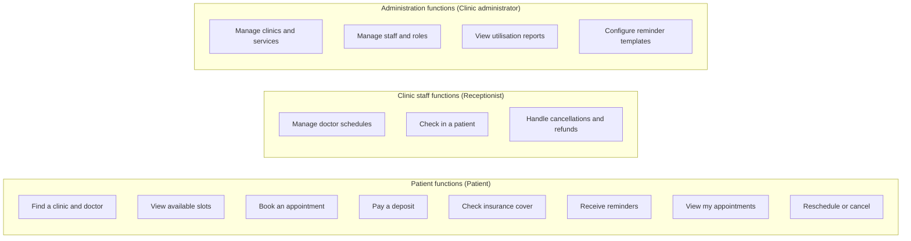

# 02 functions diagrams

Generated by sa-diagrams from the design data (source hash `2626424ee781`). Do not edit.

## Main business functions

- Functions are grouped by the actor who uses them; colours mark the groups.
