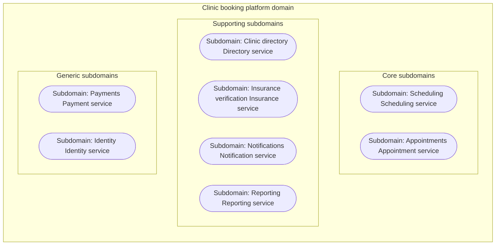

# 03 subdomains diagrams

Generated by sa-diagrams from the design data (source hash `6f3357bffe53`). Do not edit.

## Domain decomposition

- Each subdomain is owned by one service, named under the subdomain.
