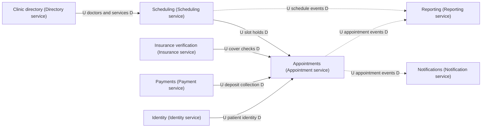

# 04 context-map diagrams

Generated by sa-diagrams from the design data (source hash `fe45862756d9`). Do not edit.

## Context map

- U = upstream (provides the model or data), D = downstream (depends on it).
