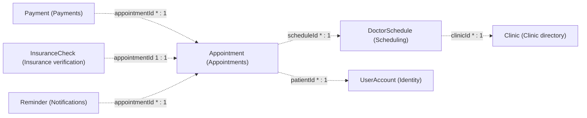

# 05 aggregates diagrams

Generated by sa-diagrams from the design data (source hash `ac874045dc13`). Do not edit.

## Aggregate roots and references

- Aggregates refer to each other by ID only; labels give the ID field and multiplicity.
- Reporting: no aggregate. Reporting only builds read models from events
