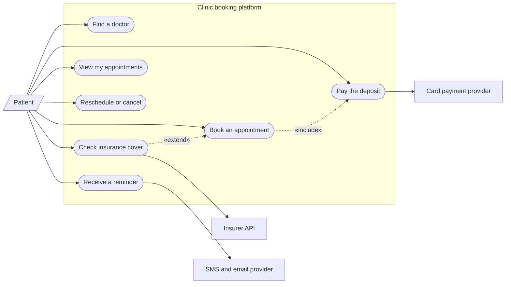
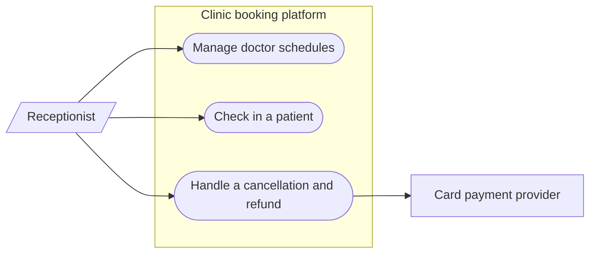
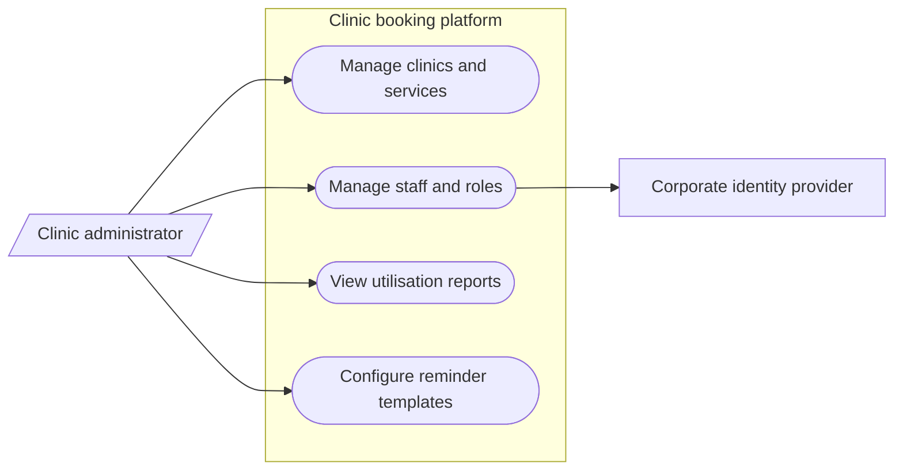

# 06 use-cases diagrams

Generated by sa-diagrams from the design data (source hash `4e243cf09a39`). Do not edit.

## Use cases: Patient functions

- People use the system on the left; external systems it calls are on the right.

## Use cases: Clinic staff functions

- People use the system on the left; external systems it calls are on the right.

## Use cases: Administration functions

- People use the system on the left; external systems it calls are on the right.
