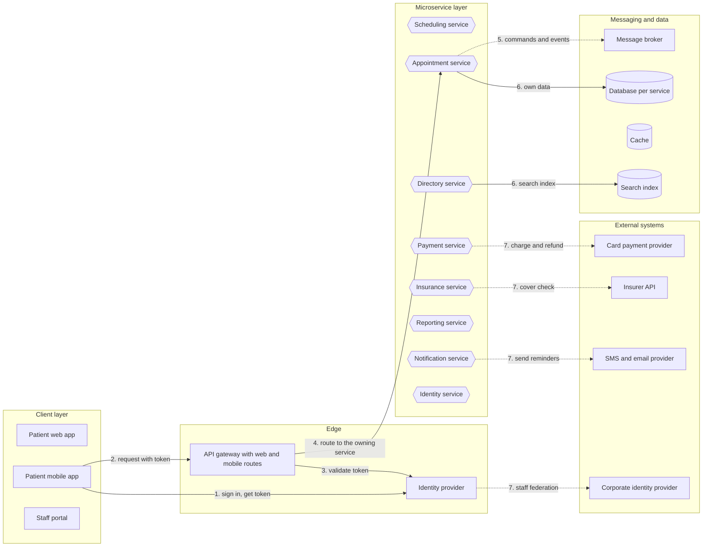

# 07 logical-view diagrams

Generated by sa-diagrams from the design data (source hash `fb9dc5e43c3c`). Do not edit.

## Logical view

- Layers from clients to external systems; arrows show the main interactions in order.
