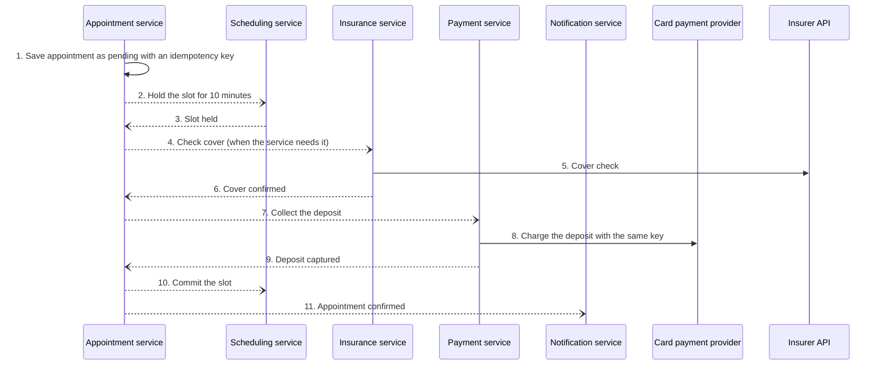
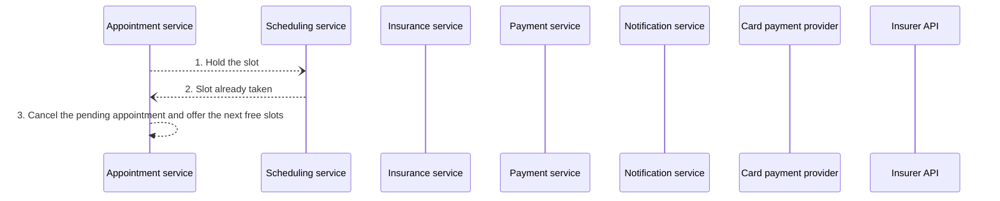
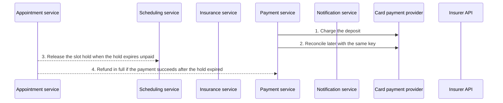

# 08 saga diagrams

Generated by sa-diagrams from the design data (source hash `edcf6c8a6342`). Do not edit.

## Saga: Book an appointment: Happy path

- Happy path (main scenario); orchestrated by Appointment service.
- Numbers give the order. Red messages are compensations.

## Saga: Book an appointment: Slot already taken

- Slot already taken (failure scenario); orchestrated by Appointment service.
- Numbers give the order. Red messages are compensations.

## Saga: Book an appointment: Deposit payment times out

- Deposit payment times out (failure scenario); orchestrated by Appointment service.
- Numbers give the order. Red messages are compensations.
