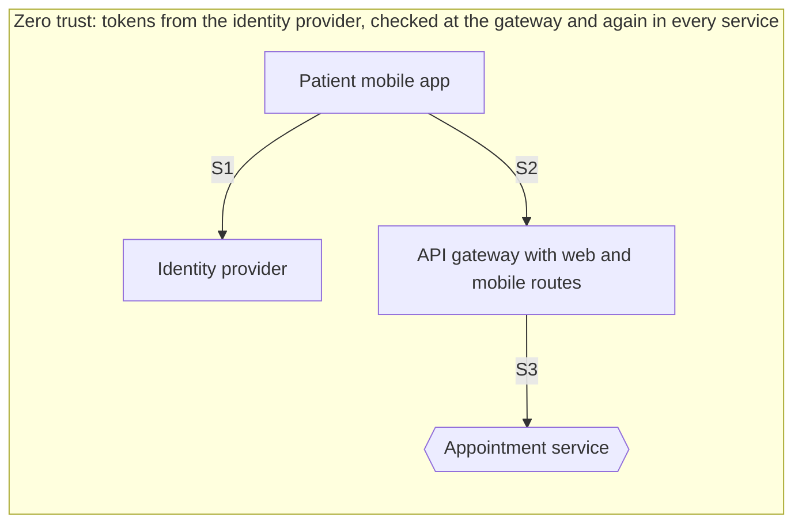
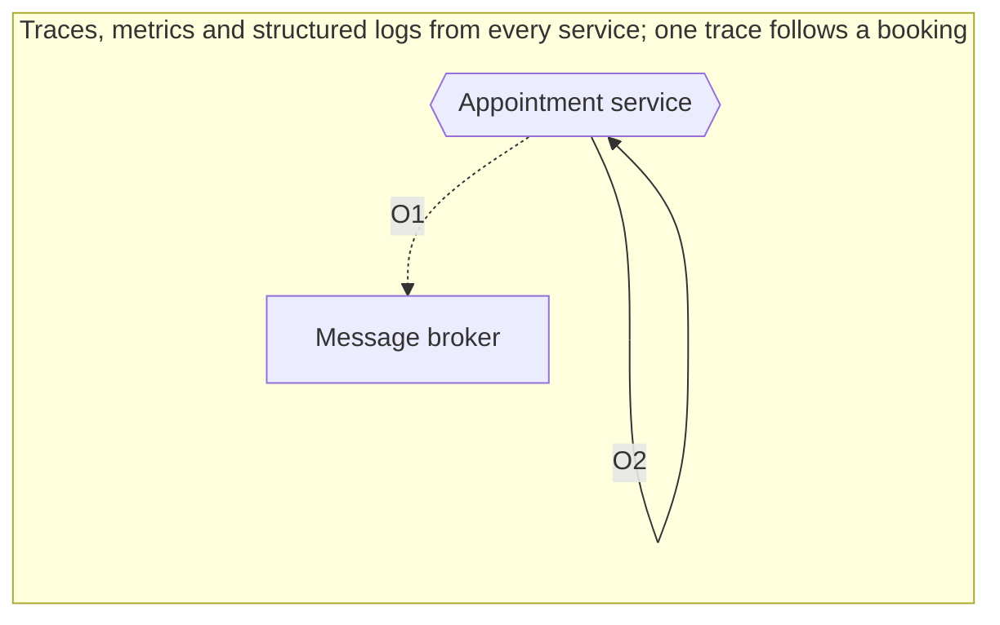
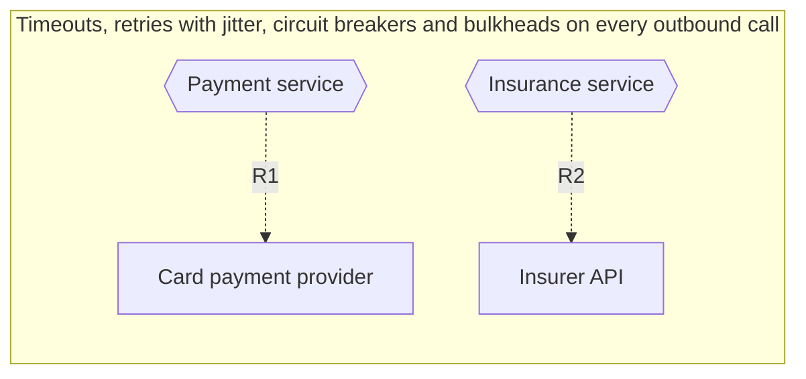

# 09 patterns diagrams

Generated by sa-diagrams from the design data (source hash `6db60c8ef4d6`). Do not edit.

## Security pattern

- S1. Sign in and get a token; staff federate through the corporate identity provider
- S2. Every call carries the token
- S3. The gateway validates the token and the service checks roles and resources

## Observability pattern

- O1. Trace context travels with commands and events through the outbox
- O2. Metrics and alarms notify the on-call team

## Resilience pattern

- R1. Timeout, retry with backoff and jitter, circuit breaker
- R2. When the circuit is open, book without the check and verify later
