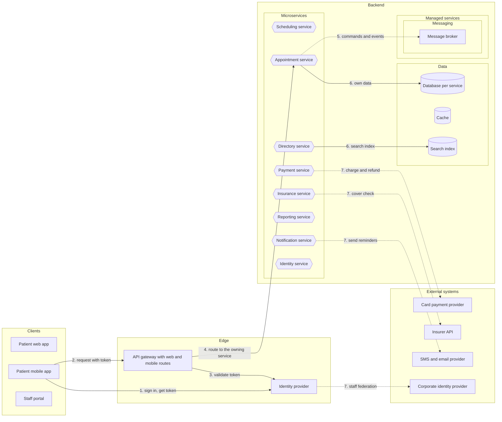
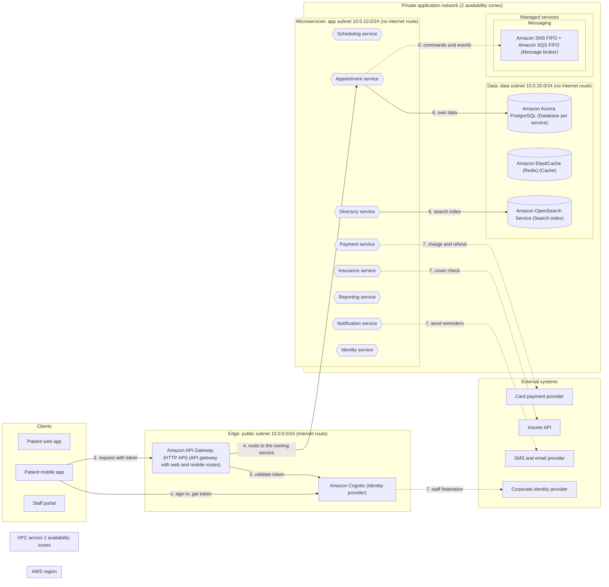

# 10 architecture diagrams

Generated by sa-diagrams from the design data (source hash `805bc86a5ac8`). Do not edit.

## High-level architecture

- Services follow the subdomain order; the physical view uses the same layout.

## Physical view and network

- The load balancer accepts only the gateway's VPC Link
- Service tasks accept only the load balancer
- Databases accept only the service tasks
- AWS services are reached through VPC endpoints
