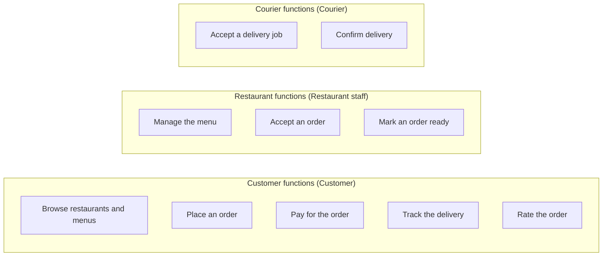

# 02 functions diagrams

Generated by sa-diagrams from the design data (source hash `9e07e3a07ddb`). Do not edit.

## Main business functions

- Functions are grouped by the actor who uses them; colours mark the groups.
