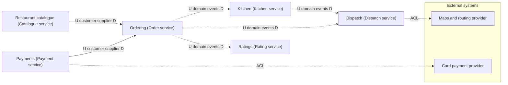

# 04 context-map diagrams

Generated by sa-diagrams from the design data (source hash `e8c06236e247`). Do not edit.

## Context map

- U = upstream (provides the model or data), D = downstream (depends on it).
- ACL = anti-corruption layer on our side of each external integration.
