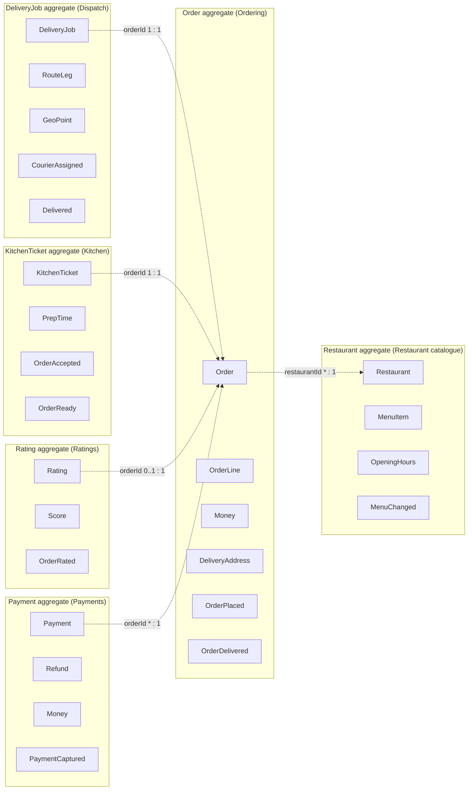

# 05 aggregates diagrams

Generated by sa-diagrams from the design data (source hash `e1a0fb41b25f`). Do not edit.

## Aggregate roots and references

- Aggregates refer to each other by ID only; labels give the ID field and multiplicity.
